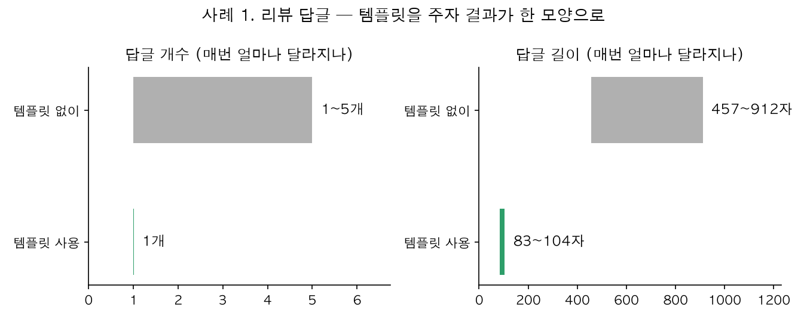

# 사례 1. 고객 리뷰 답글, AI에게 '매뉴얼'을 쥐여 주기

> 맡은 팀: **CS 팀** · 원본 실습: 15번 프롬프트 템플릿

## 한 줄 요약
AI에게 그때그때 "답글 써 줘"라고 시키던 것을 '업무 매뉴얼(템플릿)'로 바꿔, 리뷰 15개에 감정·답글·담당팀·긴급도를 명령 한 줄로 붙이고 오늘 연락할 고객 5명을 바로 찾게 했습니다.

## 문제 (Before)
- 온라인 가게 사장님이 리뷰마다 답글을 직접 쓰거나, AI에게 아무 설명 없이 "답글 써 줘"라고 맡겼습니다.
- 같은 리뷰 3개를 세 번씩 맡겨 보니 결과가 매번 달랐습니다.
  - 답글 개수: **1~5개** (한 번에 여러 버전을 줌)
  - 답글 길이: **457~912자**
  - 빈칸, 가짜 연락처, 함부로 한 보상 약속이 섞여 **그대로 쓸 수 있는 답글이 없었습니다.**
- 어떤 리뷰가 급한지(고장·누락·환불 요청)는 사람이 하나하나 읽어야 알 수 있었습니다.

## 해결 (How)
- **템플릿 4칸 틀**을 만들었습니다: 역할(가게 CS 담당) / 판단 기준 / 금지사항(지어낸 약속·연락처 금지) / 출력형식(감정·답글·내부조치·긴급도).
- 리뷰 15개를 한꺼번에 AI(Claude API)에 보내고, 결과를 엑셀로 열 수 있는 표(CSV)로 저장하는 스크립트를 만들었습니다.
- 결과를 보며 템플릿을 **3번 고쳤습니다 (v1 → v4).**
- 어려웠던 점 1 — **같은 리뷰가 실행할 때마다 '중립'과 '부정'을 오갔습니다.** 감정 기준이 적혀 있지 않아서였습니다. "별점 말고 **내용**으로 판단"이라고 기준을 직접 정해 적자 그 뒤로는 흔들리지 않았습니다.
- 어려웠던 점 2 — "교환 과정이 복잡해요" 리뷰를 긴급으로 바꾸려면 긴급 쪽에 한 줄을 더하는 것만으로는 부족했습니다. 반대쪽(일반) 규칙과 부딪히지 않게 두 곳을 함께 고쳤습니다.

## 결과 (After)
| 항목 | 템플릿 없이 | 템플릿 사용 |
|---|---|---|
| 답글 개수 | 1~5개 (매번 다름) | 항상 **1개** |
| 답글 길이 | 457~912자 | **83~104자** |
| 빈칸·가짜 연락처 | 매번 있음 | **0개** |
| 리뷰 15개 처리 | 하나씩 손으로 | 명령 **한 줄** |

- 정확도/일관성: v2부터 여러 번 돌려도 15개 모두 감정 분류가 같음 (긍정 5 / 중립 3 / 부정 7)
- 기타 효과: **오늘 연락해야 할 긴급 리뷰 5건**이 표에서 바로 보임. 같은 틀로 회의록 요약·거래처 이메일 답장 템플릿까지 확장 (모르는 숫자는 지어내지 않고 `[확인 필요]`로 비워 둠)
- 시간: 직접 재지는 않았습니다. 15개를 손으로 쓰는 대신 명령 한 줄로 끝납니다.

## 화면 / 결과물

- 결과 표: [리뷰_답글_v4.csv](https://github.com/akkayaja/claude-code-practice-kit/blob/main/15_프롬프트템플릿/결과/리뷰_답글_v4.csv)
- 템플릿 사용법: [템플릿_사용법.md](https://github.com/akkayaja/claude-code-practice-kit/blob/main/15_프롬프트템플릿/템플릿_사용법.md)
- 코드 전체: [15_프롬프트템플릿 폴더](https://github.com/akkayaja/claude-code-practice-kit/tree/main/15_프롬프트템플릿)

## 배운 점
- AI를 잘 쓴다는 건 질문을 잘하는 게 아니라 **매뉴얼을 잘 만드는 것**이다.
- 머릿속 판단 기준("이런 건 긴급")을 글로 적으면, 나중에 직원·외주에게 그대로 넘길 업무 매뉴얼이 된다.
