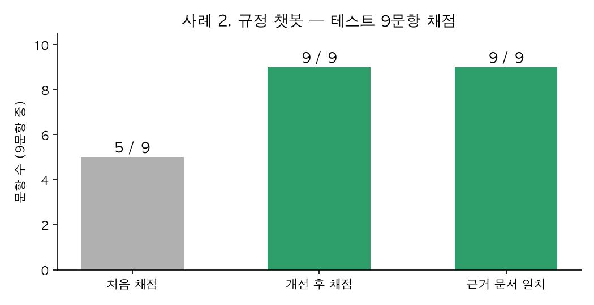

# 사례 2. 지어내지 않는 문서 기반 챗봇 (RAG)

> 맡은 팀: **CS 팀** · 원본 실습: 16번 문서 기반 AI 챗봇

## 한 줄 요약
회사 규정 문서 5개를 조각 22개로 나눠 두고, 질문에 맞는 조각만 근거로 AI가 답하는 챗봇을 만들어 테스트 9문항을 모두 맞히고, 문서에 없는 질문에는 지어내지 않고 "문서에 없다"고 답하게 했습니다.

## 문제 (Before)
- 직원들이 휴가·출장비·보안·복지·재택 규정을 물을 때마다 담당자가 문서를 찾아 답해야 했습니다.
- 일반 AI에게 물으면 우리 회사 규정을 모르기 때문에 **그럴듯하게 지어낼 위험**이 있었습니다. 틀린 규정 안내는 그대로 회사의 실수가 됩니다.

## 해결 (How)
- 규정 문서 5개를 항목 단위 **조각 22개**로 나누고, 조각마다 '문서 제목 > 소제목' 이름표를 붙였습니다.
- 질문이 들어오면 비슷한 조각을 먼저 찾고, AI(Claude)는 **찾은 조각만 보고** 답하게 했습니다. 비유하면 '규정 바인더를 펴 놓고만 답하는 직원'입니다.
- 답마다 **근거 문서 이름**을 표시하고, 간단한 웹 채팅 화면도 붙였습니다.
- 테스트 질문 9개를 만들어 AI 채점자가 자동으로 채점하게 했습니다.
- 어려웠던 점 1 — 검색기는 "관련 없음"을 판단하지 못합니다. 문서에 없는 '주차비' 질문에도 엉뚱한 조각을 가져왔습니다. 그래서 답하는 AI에게 "조각에 답이 없으면 '문서에 없다'고만 말하라"는 규칙을 넣었습니다.
- 어려웠던 점 2 — 처음 채점은 **5/9**였습니다. 틀린 이유를 따져 보니 챗봇이 문서에 **실제로 있는 내용**을 친절하게 덧붙였는데, 문서를 못 본 채점자가 "지어냈다"고 처리한 것이었습니다. 채점자에게도 근거 조각을 보여 주도록 기준을 바꾸자 **9/9**가 됐습니다.

## 결과 (After)
| 항목 | 처음 | 개선 후 |
|---|---|---|
| 테스트 9문항 채점 | 5 / 9 (실행마다 흔들림) | **9 / 9** (4번 실행 모두 같음) |
| 문서에 없는 질문(주차비) | — | 지어내지 않고 **"문서에 없는 내용이에요"** |
| 근거 문서 표시 | 없음 | **9문항 중 9개** 정답과 일치 |
| 검색 (AI 없이) | — | 문서가 있는 질문 **8개 중 8개**에서 1등 조각이 정답 문서 |

- 기타 효과: 규정 질문에 몇 초 만에 근거와 함께 답합니다. 문서가 바뀌면 조각 나누기 스크립트만 다시 실행하고, 채점을 다시 돌려 답이 여전히 맞는지 확인할 수 있습니다.

## 화면 / 결과물

- 채점 결과: [채점결과.csv](https://github.com/akkayaja/claude-code-practice-kit/blob/main/16_문서기반AI챗봇/결과/채점결과.csv)
- 사용설명서: [사용설명서.md](https://github.com/akkayaja/claude-code-practice-kit/blob/main/16_문서기반AI챗봇/사용설명서.md)
- 코드 전체: [16_문서기반AI챗봇 폴더](https://github.com/akkayaja/claude-code-practice-kit/tree/main/16_문서기반AI챗봇)

## 배운 점
- 믿고 쓸 수 있는 챗봇의 핵심은 똑똑한 답보다 **"모르면 모른다고 하기"**다.
- 점수가 낮을 때는 챗봇만 의심하지 말고 **채점 기준**도 함께 의심해야 한다.
- 같은 방식으로 외부 고객 CS 챗봇(배송·교환·환불 정책, FAQ)도 만들 수 있다.
