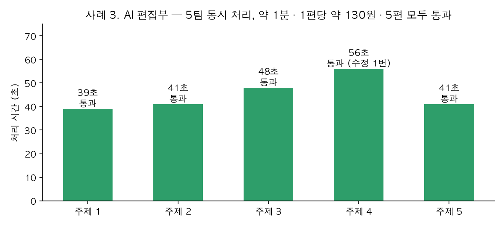

# 사례 3. 기획자·작가·편집장, AI 편집부 꾸리기

> 맡은 팀: **콘텐츠 팀** · 원본 실습: 17번 AI 에이전트 워크플로우

## 한 줄 요약
글 한 편의 기획 → 초안 → 검수 → 수정을 역할별 AI 직원 3명에게 나눠 맡겨 자동으로 잇고, 주제 5개를 약 1분, 글 1편당 약 130원에 처리해 5편 모두 검수를 통과시켰습니다. 발행 버튼은 사람이 누릅니다.

## 문제 (Before)
- 글 하나를 쓰려면 기획·초안·검수·수정을 사람이 차례로 해야 했습니다.
- 검수 기준 6가지(제목 길이, 분량, 첫 3문장 안에 핵심, 근거 없는 숫자 등)를 **눈으로 하나하나** 확인해야 했습니다.
- 특히 분량(글자 수)은 사람도 AI도 정확히 세기 어렵습니다.

## 해결 (How)
- AI 직원을 역할별로 나눴습니다: ① 기획자(개요) → ② 작가(초안) → ③ 편집장(검수) → ④ 작가(수정).
- 검수에서 떨어지면 고쳐서 다시 검수받는 **되돌이 고리**를 만들고, 끝없이 돌지 않게 **최대 2번**에서 멈추고 사람에게 넘기게 했습니다.
- 주제 5개를 **5팀이 동시에** 처리하게 하고, 단계별 시간·비용을 기록했습니다.
- 발행 전 **사장님 승인 단계**를 두었습니다. 반려하면 반려 이유가 그대로 작가의 수정 지시가 됩니다.
- 같은 흐름을 Claude Code 서브에이전트(직원 등록증 3장 + 지휘서)로도 만들어, **말로** 시킬 수 있게 했습니다.
- 어려웠던 점 1 — 글자 수는 AI가 자주 틀렸습니다. **계산은 코드, 판단은 AI**로 나누자 목표 범위에 **1자 모자란** 글까지 정확히 잡아냈습니다.
- 어려웠던 점 2 — '핵심', '근거 없는 숫자'처럼 해석이 갈리는 기준은 결과가 흔들렸습니다. 기준을 A/B 중에서 제가 직접 정해 매뉴얼에 적자 일정해졌습니다.

## 결과 (After)
| 항목 | 결과 |
|---|---|
| 처리 시간 | 주제 5개 **약 1분** (가장 늦은 팀 56초) |
| 비용 | 5편 648원 → **글 1편당 약 130원** (1달러 = 1,400원 기준) |
| 검수 결과 | **5편 모두** 6개 항목 통과 (수정은 총 1번) |
| 기록 | 검수·수정·시간·비용이 표(CSV)로 남아, 어디서 자주 걸리는지 숫자로 확인 |

- 시간: 사람이 직접 쓰는 시간은 재지 않았습니다. AI 쪽은 실행 기록에 남은 숫자입니다.
- 기타 효과: 사람은 마지막 **승인·반려**만 하면 됩니다.

## 화면 / 결과물

- 5편 요약표: [요약.csv](https://github.com/akkayaja/claude-code-practice-kit/blob/main/17_AI에이전트워크플로우/결과/전체/요약.csv)
- 서브에이전트 지휘서: [서브에이전트_지휘서.md](https://github.com/akkayaja/claude-code-practice-kit/blob/main/17_AI에이전트워크플로우/서브에이전트_지휘서.md)
- 코드 전체: [17_AI에이전트워크플로우 폴더](https://github.com/akkayaja/claude-code-practice-kit/tree/main/17_AI에이전트워크플로우)

## 배운 점
- 말로 시키더라도 **기준은 내가 정해야** 결과가 흔들리지 않는다.
- 정확해야 하는 일(글자 수 세기)은 코드에, 판단은 AI에, 마지막 결정은 사람에게 맡긴다.
- 같은 방식으로 1인 사업의 CS 팀·콘텐츠 팀·보고 팀을 AI 직원으로 꾸릴 수 있다.
